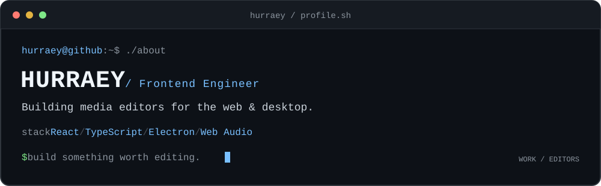

  

# 김승진 · Frontend Engineer

React·TypeScript·Electron으로 미디어 에디터를 만듭니다.  
오디오 타임라인, 편집 상태, 실행 취소처럼 복잡한 상호작용을 다룹니다.

[블로그](https://devlog.dropai.site/) · [VOIX KIT](https://kit.an-ai.ai/) · [이력서](https://app.notion.com/p/Software-Engineer-38073b56612a80efb6e1f5f7055e5c15) · [개인 GitHub](https://github.com/whizzkid1452)

### `$ cat focus.md`

- **미디어 편집 경험** - 웹·데스크톱에서 오디오를 배치하고 편집하는 화면을 만듭니다.
- **예측 가능한 상태 변경** - 편집 명령과 작업 이력, 저장할 데이터의 경계를 설계합니다.
- **오디오 타임라인** - 파형과 Canvas, 가상 스크롤을 이용해 편집 화면을 구성합니다.

### `$ ls projects/`

#### [daw-engine](https://github.com/HURRAEY/daw-engine)

멀티트랙 오디오 편집기를 위한 TypeScript 라이브러리입니다.  
원본을 보존하는 편집 모델과 실행 취소·재실행, 믹싱·라우팅, 재생·출력 흐름을 제공합니다.

[소스 코드](https://github.com/HURRAEY/daw-engine) · [편집 코어](https://github.com/HURRAEY/daw-engine/tree/main/core) · [타임라인 UI 도구](https://github.com/HURRAEY/daw-engine/tree/main/ui-utils)

#### [VOIX KIT](https://kit.an-ai.ai/)

웹 기반 AI 음성 변환 서비스입니다.  
미디어 제품과 편집 경험에 대한 관심은 공개 오디오 엔진과 개인 프로젝트로도 이어가고 있습니다.

### `$ cat stack.txt`

`TypeScript` `React` `Electron` `Web Audio API` `Canvas`

### `$ git log --oneline`

- [Tone.js #1453](https://github.com/Tonejs/Tone.js/pull/1453) - 일부 테스트만 실행하던 설정을 제거하고, 오디오 게이트 테스트의 검증 조건을 보완했습니다. **Merged**
- [개인 프로젝트와 오픈소스 기여 더 보기](https://github.com/whizzkid1452)

---

[HURRAEY](https://github.com/HURRAEY) · 실무·에디터 개발 / [whizzkid1452](https://github.com/whizzkid1452) · 개인 프로젝트·기술 글
